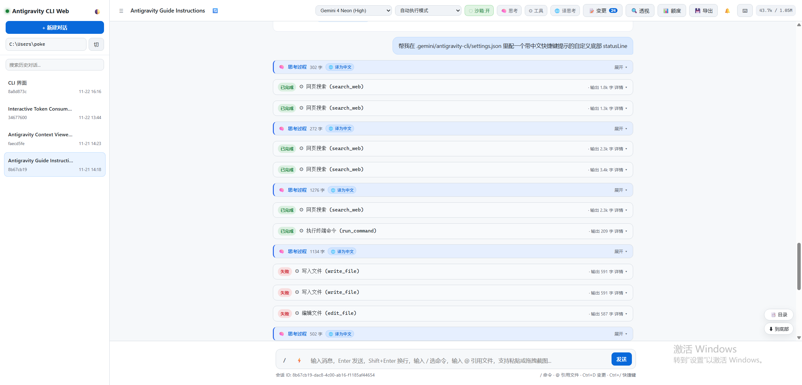
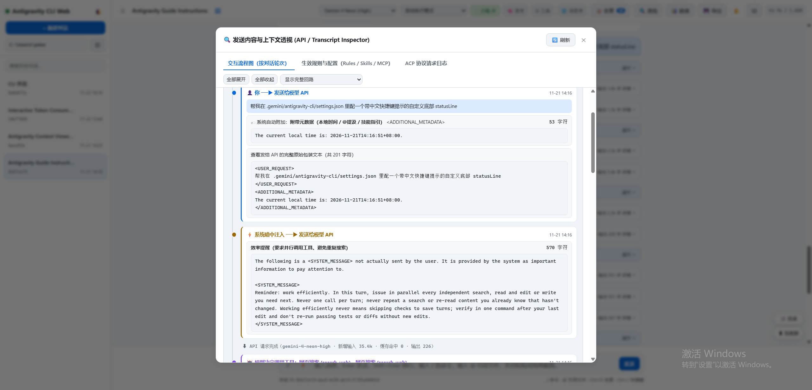

# Antigravity CLI Web (`agy-web`)

> 一个**零外部依赖、仅 ~64 KB、全中文、把黑盒变白盒**的本地网页工作台——直连本机官方 `agy acp`，100% 复用官方模型、账号额度、工具生态与系统级沙箱，同时全面补齐原生终端 CLI 的高频交互短板。


---

## 界面预览

### 1. 主工作台（全中文界面 · 思考译为中文 · 沙箱与自动模式 · 工具输出与变更角标）



### 2. 发送内容与上下文透视（按对话轮次还原用户输入与系统暗中注入）



---

## 为什么选择 `agy-web`？（对比官方原生 CLI）

| 维度 | 官方原生 CLI (`agy`) | `agy-web` |
| :--- | :--- | :--- |
| **思考过程 & 翻译** | 默认折叠/简略展示，摘要常为英文 | **默认实时流式展开完整思考 + 0 Token 自动中译**（多免费引擎 429 冷却降级、系统代理自识别、SHA-256 本地缓存、可视区懒加载、一键切中文/原文） |
| **多任务并行** | 单终端一次只能盯 1 个会话，并行需手动开多窗口 | **单页面真正多会话后台并行**（`--process-per-session` 独立状态池），侧边栏实时显示 `⏳ 执行中` / `⚠ 待审批` / `✓ 完成`，秒切不中断 + 后台桌面通知 (`🔔`) |
| **全中文效率流** | 全英文命令/模式/权限项，需记参数与快捷键 | **全界面深度汉化**：`/` 斜杠命令支持**中文关键词搜索**、中文快捷键速查 (`⌨`)、`@` 工作区文件补全、常用提示词模板库 (`⚡`)、粘贴/拖拽截图 |
| **白盒上下文透视** | 终端内黑盒运行，看不到系统附加标签与生效规则 | **按轮次因果交互流程图 (`Ctrl+I`)**：拆解用户输入、系统隐藏标签、工具回传与每轮 Token；支持查看并**在线编辑保存 `GEMINI.md` 等规则文件** |
| **历史与输出管理** | 仅基础 `/resume`，无法重命名、隐藏、删除或导出 | **中文重命名 / 仅隐藏 / 彻底删除**、完整磁盘日志自动同步（含 `/compact` 检查点与报错）、工具卡片全局展开与全文展开、轮次目录 (`📑`)、导出 Markdown (`💾`) |
| **代码审阅 & 额度** | 需手动跑 `git diff` 和 `/usage` 读纯文本 | 顶栏变更角标 + **红绿高亮 Git Diff 审阅 (`Ctrl+D`)**；可视化**模型配额进度条与重置倒计时 (`Ctrl+U`)** |
| **沙箱 & 权限体验** | 默认高频弹窗，需手动配 `settings.json` 或记参数 | **开箱默认自动执行模式 (`auto`) + 自动记住模式偏好**；顶栏一键热切换 **`🛡 沙箱:开/关`**，兼顾隔离安全与免打扰 |
| **体量与便携性** | 依赖终端排版，长代码/表格复制不便 | **0 外部 npm 依赖、6 个核心文件**，免 `npm install`，跨平台双击即用，纯 `127.0.0.1` 本地运行 |

---

## 核心功能一览

- **🧠 流式思考展开 + 🌐 0 Token 智能翻译**
  - 实时流式展开完整思考过程，不吞细节；
  - 内置零大模型 Token 消耗的免费多引擎翻译（自动走系统代理、独立 429 冷却降级、本地 SHA-256 持久化缓存）；
  - 基于 `IntersectionObserver` 的**可视区域懒翻译**，浏览上百轮长历史对话也不会触发限流，且每条思考块均可一键切换中文译文/英文原文。
- **⚡ 真正的多会话后台并行**
  - 底层以 `agy acp --process-per-session` 运行，每个会话拥有独立状态与权限队列；
  - 执行长耗时任务时可随时切换至其他会话并行开工，后台完成或等待审批时通过侧边栏徽章、动态标签页标题和桌面通知 (`🔔`) 及时提醒。
- **🛡 终端沙箱与默认自动执行模式**
  - 开箱默认「自动执行模式 (`auto`)」，切换模式后自动持久化记住并应用到后续全部新建与加载会话；
  - 顶栏一键开关 **`🛡 沙箱`**（自动热重启底层 `agy acp --sandbox`，若存在运行中任务则安全拦截防止误中断）。
- **🔍 交互流程图透视 & 规则在线编辑 (`Ctrl+I`)**
  - 按对话轮次以垂直因果流还原每一轮的用户提问、系统附加元数据、`<SYSTEM_MESSAGE>` 注入与工具回传；
  - 集中展示当前生效的 Rules / Skills / MCP / `settings.json`（自动脱敏密钥），支持在白名单校验下直接在线编辑保存规则文件。
- **📝 Git Diff 审阅 (`Ctrl+D`) & 📊 额度面板 (`Ctrl+U`)**
  - 顶栏角标实时提示未提交改动文件数，弹窗内红绿高亮逐文件审阅（非 Git 目录自动汇总本会话编辑记录）；
  - 一键调用本机 `agy --print /usage` 可视化展示模型分组剩余配额、重置倒计时与本会话累计 Token 消耗。
- **🗂 完整的对话管理与写作效率工具**
  - 支持历史对话中文重命名、仅网页隐藏/恢复、彻底删除本机记录；
  - 切回标签页自动静默同步本机 `transcript_full.jsonl`（完整还原 `/compact` 压缩检查点、报错记录与全量工具输出）；
  - 支持 `@` 模糊搜索并引用工作区文件、粘贴/拖拽发图、提示词模板库 (`⚡`)、消息悬浮复制/重填、右下角轮次目录 (`📑`)、一键导出 Markdown (`💾`)。

---

## 快速开始

### 环境要求
1. 已安装并登录 **Antigravity CLI (`agy`)**。
2. 已安装 **Node.js v18+**（无需执行 `npm install`，零第三方依赖）。

### 启动方式

- **Windows**：
  - 直接双击 `start.bat` 启动并自动打开浏览器；
  - 也支持将任意项目文件夹**直接拖到 `start.bat` 图标上**，以该目录为工作区启动。
- **macOS / Linux**：
  ```bash
  chmod +x start.sh && ./start.sh
  # 或指定项目目录启动
  ./start.sh /path/to/your/project
  ```
- **命令行高级参数**：
  ```bash
  node server.js --open --port 3456 --cwd "/你的项目路径" --sandbox --mode auto
  ```
  - `--open`：启动后自动打开默认浏览器（端口冲突时自动顺延最多 20 次）。
  - `--port <number>`：指定监听端口（默认 `3456`）。
  - `--cwd <path>`：指定初始工作目录。
  - `--sandbox` / `--no-sandbox`：本次启动强制开启或关闭 CLI 终端沙箱（未传时自动沿用网页中保存的偏好）。
  - `--mode <default|accept-edits|auto|plan>`：指定默认执行模式（未传时默认 `auto`，并在网页切换后自动记住）。

---

## 常用快捷键

| 快捷键 | 功能 |
| :--- | :--- |
| `Enter` / `Shift+Enter` | 发送消息 / 换行 |
| `/` | 呼出中文斜杠命令菜单（支持输入中文关键词筛选） |
| `@` | 模糊搜索并引用当前工作区文件 |
| `Ctrl+V` | 直接粘贴截图（也支持拖拽图片到输入框） |
| `Ctrl+D` | 打开工作区代码变更与 Git Diff 审阅 |
| `Ctrl+I` | 打开交互流程图透视、规则在线编辑与 ACP 日志 |
| `Ctrl+U` | 打开模型额度进度条与 Token 消耗面板 |
| `Ctrl+M` | 一键全部展开 / 折叠思考过程 |
| `Ctrl+K` | 新建空白对话 |
| `Ctrl+B` | 收起 / 展开左侧历史会话栏 |
| `Ctrl+Shift+L` | 切换深色 / 浅色主题 |
| `Ctrl+/` | 打开中文快捷键与斜杠命令速查 |
| `Esc` | 停止当前生成 / 关闭菜单与弹窗 |

---

## 项目结构与安全设计

```text
agy-web/
├── server.js          # 零依赖 Node.js 后端（ACP 桥接、多会话池、SSE、翻译、Diff、透视 API）
├── public/
│   └── index.html     # 纯离线单文件前端（HTML/CSS/JS 全内置，无 CDN 依赖）
├── start.bat          # Windows 一键启动脚本
├── start.sh           # macOS / Linux 一键启动脚本
├── package.json       # 项目元信息
├── CHANGELOG.md       # 版本迭代记录
└── data/              # 运行时自动生成（已被 .gitignore 忽略：别名、隐藏列表、模板库、翻译缓存、偏好）
```

- **纯本地运行**：服务默认仅绑定 `127.0.0.1`，不对外暴露，不经过任何第三方中转服务器。
- **复用官方引擎**：底层直连本机官方 `agy acp`，官方发布新模型与新技能时自动同步可用。
- **严格安全校验**：规则在线保存仅允许白名单路径（防路径穿越），删除会话严格校验会话 ID 格式，配置展示自动脱敏敏感字段。

---

## 版本记录与导出便携包

查看完整版本迭代请见 [CHANGELOG.md](./CHANGELOG.md)。如需随时导出任意历史版本的纯净便携包：

```bash
git archive --format=zip --output=agy-web-portable.zip HEAD
```
